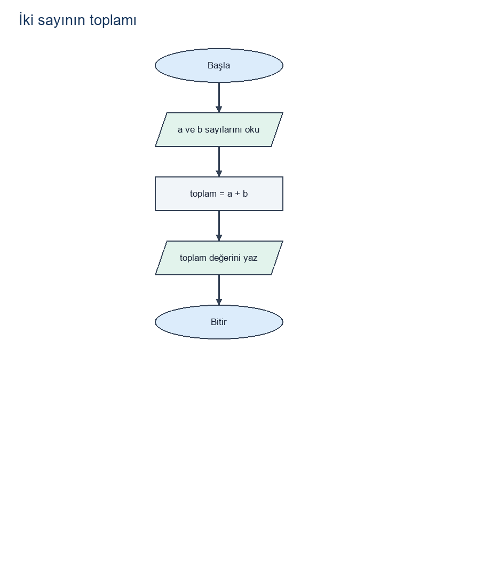
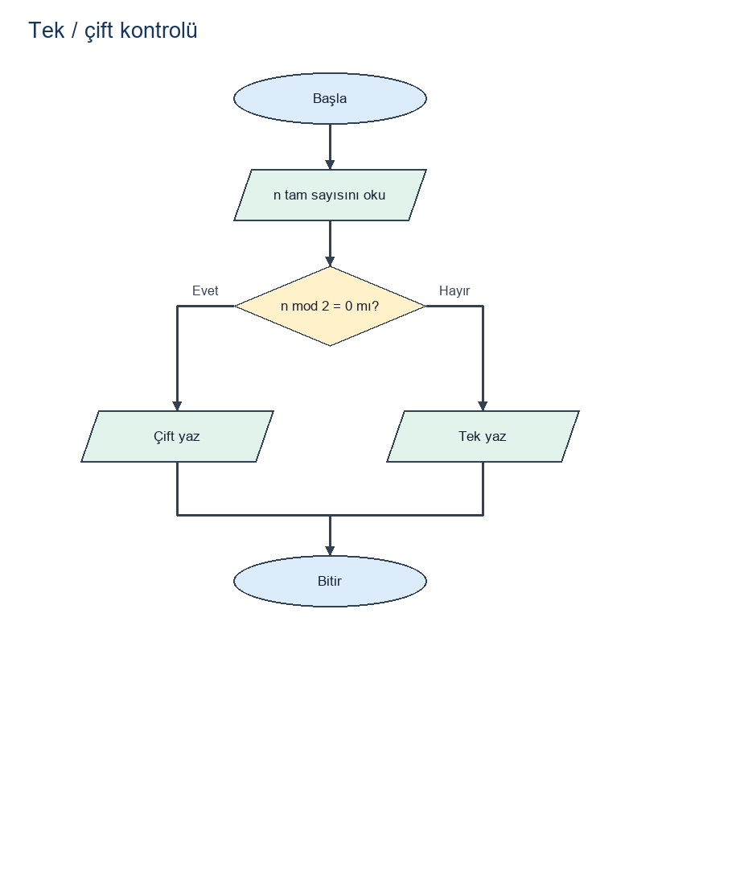
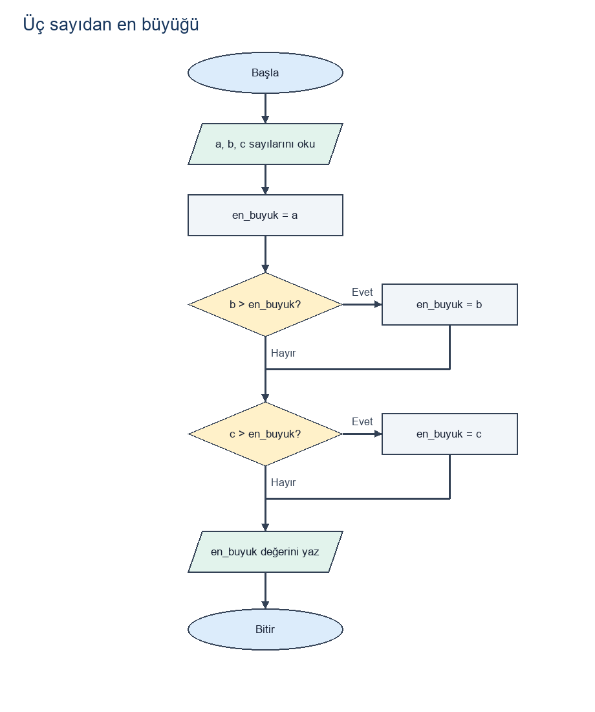
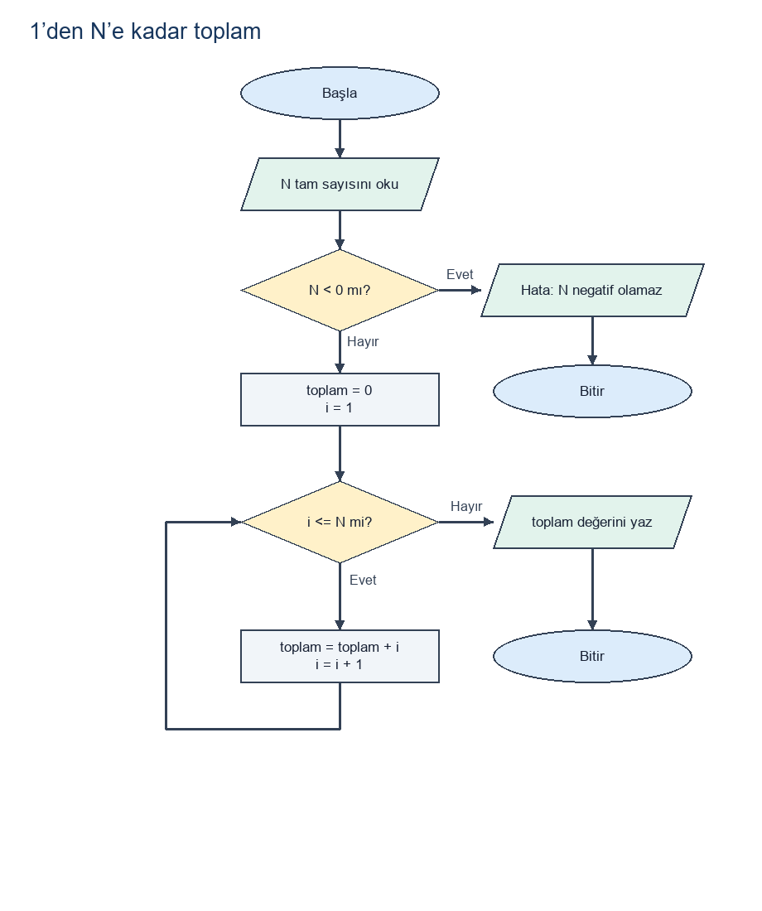

# Algoritma eğitimi — önerilen örnekler

Algoritma eğitimini izledim. Bu bölümde algoritmik düşünme, girdi/çıktı belirleme, koşul ve döngü kavramlarını ele alan beş örnek bulunur. Örnekler eğitim belgesindeki resmî bir soru listesi değildir.

## Dosyaları açma

PNG dosyaları doğrudan görüntülenebilir. `.drawio` kaynakları [diagrams.net](https://app.diagrams.net/) üzerinde **File → Open From → Device** yoluyla açılabilir. Kaynaklar standart mxfile XML biçimindedir ve şekiller düzenlenebilir. PNG önizlemeler aynı düğüm ve bağlantı tanımlarını kullanır.

## Semboller ve girdi varsayımları

- Oval: başlangıç / bitiş.
- Paralelkenar: girdi / çıktı.
- Dikdörtgen: işlem veya atama.
- Eşkenar dörtgen: karar; çıkışlar Evet ve Hayır olarak etiketlidir.
- Ok: işlem sırası; geriye dönen ok döngüyü gösterir.

Örnekler, girişin belirtilen sayısal türde olduğunu varsayar. Metin ayrıştırma, boş giriş ve sayısal olmayan girişleri yeniden isteme bu temel şemaların kapsamı dışındadır. Toplam ve en büyük sayı örnekleri sonlu sayılarla çalışır; tek/çift, seri toplamı ve faktöriyel tam sayı alır. Son iki şema negatif girdiyi ayrıca reddeder. Matematiksel aritmetik varsayılır; gerçek dilde taşma, kayan nokta hassasiyeti ve büyük girdilerin çalışma süresi ayrıca değerlendirilmelidir.


## İki sayının toplamı

İki sayıyı toplayıp sonucu gösterir.

**Girdi:** a ve b: iki sonlu sayı.

**Çıktı:** toplam = a + b.

**İşlem adımları:**

1. Başla.
2. a ve b sayılarını al.
3. toplam = a + b hesapla.
4. toplam değerini göster.
5. Bitir.

```text
OKU a, b
toplam ← a + b
YAZ toplam
```

[Draw.io kaynağı](flowcharts/01-iki-sayinin-toplami.drawio) · [PNG önizleme](flowcharts/01-iki-sayinin-toplami.png)



**Kontrol örnekleri:**

| Girdi | Beklenen çıktı | Kontrol |
| --- | --- | --- |
| a=2, b=3 | 5 | Geçti |
| a=-4, b=4 | 0 | Geçti |
| a=1.5, b=2.25 | 3.75 | Geçti |
| a=0, b=0 | 0 | Geçti |


## Tek / çift kontrolü

Bir tam sayının 2 ile bölümünden kalanına bakarak tek veya çift olduğunu belirler.

**Girdi:** n: bir tam sayı; negatif değerler ve sıfır geçerlidir.

**Çıktı:** Çift veya Tek.

**İşlem adımları:**

1. Başla ve n tam sayısını al.
2. n mod 2 = 0 koşulunu değerlendir.
3. Evet ise Çift, hayır ise Tek yaz.
4. Bitir.

```text
OKU n
EĞER n mod 2 = 0 İSE
    YAZ "Çift"
DEĞİLSE
    YAZ "Tek"
```

[Draw.io kaynağı](flowcharts/02-tek-cift-kontrolu.drawio) · [PNG önizleme](flowcharts/02-tek-cift-kontrolu.png)



**Kontrol örnekleri:**

| Girdi | Beklenen çıktı | Kontrol |
| --- | --- | --- |
| n=0 | Çift | Geçti |
| n=2 | Çift | Geçti |
| n=7 | Tek | Geçti |
| n=-3 | Tek | Geçti |
| n=-4 | Çift | Geçti |


## Üç sayıdan en büyüğü

Üç sayının en büyük değerini bulur. Eşitlik varsa ortak en büyük değer bir kez gösterilir.

**Girdi:** a, b, c: üç sonlu sayı.

**Çıktı:** en_buyuk: üç girdinin en büyük değeri.

**İşlem adımları:**

1. Başla; a, b, c sayılarını al.
2. en_buyuk = a olarak başlat.
3. b > en_buyuk ise en_buyuk = b yap.
4. c > en_buyuk ise en_buyuk = c yap.
5. en_buyuk değerini göster ve bitir.

```text
OKU a, b, c
en_buyuk ← a
EĞER b > en_buyuk İSE en_buyuk ← b
EĞER c > en_buyuk İSE en_buyuk ← c
YAZ en_buyuk
```

[Draw.io kaynağı](flowcharts/03-en-buyuk-sayi.drawio) · [PNG önizleme](flowcharts/03-en-buyuk-sayi.png)



**Kontrol örnekleri:**

| Girdi | Beklenen çıktı | Kontrol |
| --- | --- | --- |
| a=9, b=2, c=1 | 9 | Geçti |
| a=1, b=9, c=2 | 9 | Geçti |
| a=1, b=2, c=9 | 9 | Geçti |
| a=-8, b=-2, c=-5 | -2 | Geçti |
| a=4, b=4, c=1 | 4 | Geçti |
| a=3, b=3, c=3 | 3 | Geçti |
| a=1, b=4, c=4 | 4 | Geçti |


## 1’den N’e kadar toplam

1 ile N arasındaki tam sayıları, N dâhil, döngüyle toplar. N = 0 için boş toplam 0 kabul edilir.

**Girdi:** N: bir tam sayı. Negatif değer hata mesajıyla reddedilir.

**Çıktı:** toplam: hesaplanan değer; N < 0 ise hata mesajı.

**İşlem adımları:**

1. Başla ve N tam sayısını al.
2. N < 0 ise hata yaz ve bitir.
3. toplam = 0, i = 1 olarak başlat.
4. i <= N ise toplam = toplam + i hesapla; i = i + 1 yap ve koşula dön.
5. i > N olduğunda toplam değerini göster ve bitir.

```text
OKU N
EĞER N < 0 İSE
    YAZ "Hata: N negatif olamaz"
    BİTİR
toplam ← 0
i ← 1
İKEN i <= N
    toplam ← toplam + i
    i ← i + 1
YAZ toplam
```

[Draw.io kaynağı](flowcharts/04-birden-nye-toplam.drawio) · [PNG önizleme](flowcharts/04-birden-nye-toplam.png)



**Kontrol örnekleri:**

| Girdi | Beklenen çıktı | Kontrol |
| --- | --- | --- |
| N=-1 | Hata | Geçti |
| N=0 | 0 | Geçti |
| N=1 | 1 | Geçti |
| N=2 | 3 | Geçti |
| N=5 | 15 | Geçti |
| N=10 | 55 | Geçti |


## Faktöriyel hesaplama

Negatif olmayan bir tam sayının faktöriyelini döngüyle hesaplar. 0! = 1 kabul edilir.

**Girdi:** N: bir tam sayı. Negatif değer hata mesajıyla reddedilir.

**Çıktı:** sonuc: hesaplanan değer; N < 0 ise hata mesajı.

**İşlem adımları:**

1. Başla ve N tam sayısını al.
2. N < 0 ise hata yaz ve bitir.
3. sonuc = 1, i = 1 olarak başlat.
4. i <= N ise sonuc = sonuc * i hesapla; i = i + 1 yap ve koşula dön.
5. i > N olduğunda sonuc değerini göster ve bitir.

```text
OKU N
EĞER N < 0 İSE
    YAZ "Hata: N negatif olamaz"
    BİTİR
sonuc ← 1
i ← 1
İKEN i <= N
    sonuc ← sonuc * i
    i ← i + 1
YAZ sonuc
```

[Draw.io kaynağı](flowcharts/05-faktoriyel.drawio) · [PNG önizleme](flowcharts/05-faktoriyel.png)


**Kontrol örnekleri:**

| Girdi | Beklenen çıktı | Kontrol |
| --- | --- | --- |
| N=-1 | Hata | Geçti |
| N=0 | 1 | Geçti |
| N=1 | 1 | Geçti |
| N=2 | 2 | Geçti |
| N=5 | 120 | Geçti |
| N=10 | 3628800 | Geçti |


## Doğrulama ve döngülerin sonlanması

Şemaları üreten düğüm/ok modeli yürütülerek 28 örnek test kontrol edildi; sonuçlar bağımsız beklenen değerlerle karşılaştırıldı. XML dosyaları tekrar ayrıştırıldı; kararların Evet/Hayır çıkışları ve düğüm bağlantıları denetlendi. Bu kontrol, diagrams.net uygulamasında açma testi yerine geçmez.

Toplam ve faktöriyel döngülerinde i = 1 ile başlanır ve her turda i bir artırılır. Sonlu N ≥ 1 için N turdan sonra i = N + 1 olur ve koşul yanlış olur. N = 0 için döngüye girilmez: toplam 0, faktöriyel 1 kalır. Negatif N hata dalından biter. Üç sayının en büyüğünde karşılaştırmalar bağımsız olarak sırayla yapılır; b'nin seçilmesi c'nin karşılaştırılmasını atlatmaz.

## Temel kavramlar

- Problem, girdi, çıktı ve varsayım arasındaki fark.
- Atama ile karşılaştırmanın farkı; sözde kodun amacı.
- Mod işlemi; sıfırın ve negatif tam sayıların tek/çift davranışı.
- Koşul dalları ve eşit sayıların karşılaştırılması.
- Sayaç ve biriktirici; toplamın 0, çarpımın 1 ile başlatılma nedeni.
- Döngü sınırının `i <= N` olması ve sonsuz döngünün nasıl önlendiği.
- 0! = 1, boş toplam, negatif girdi ve sınır durumları.
- Bir şemayı elle izleyip her adımda değişken değerlerini yazma.

Sunum hazırlığı için her örnek farklı girdilerle elle izlenebilir; değişkenlerin her adımdaki değerleri bir tabloya yazılabilir. Koşul veya döngü sınırı değiştirilerek sonucun nasıl etkilendiği incelenebilir.
